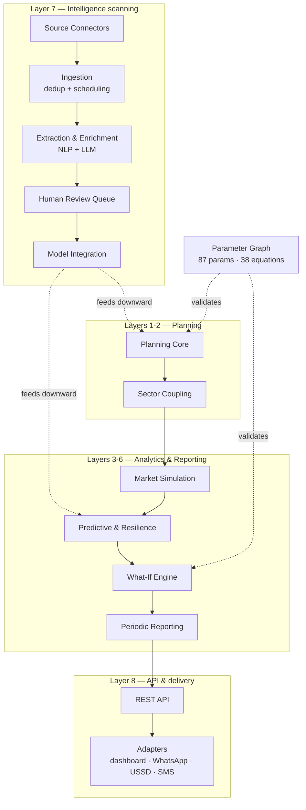

# Alea — African Light and Energy Analytics

**An open, continental decision-support platform for African energy systems.**

Alea forecasts the physical, market, financial, and strategic behaviour of
African power systems across all 55 African Union member states and the five
regional power pools — and delivers those forecasts through channels that reach
everyone from a national utility control room to a feature phone in rural
Malawi.

It is the successor to a South-Africa-only subscription report model (COMPASS,
Meridian Economics), widened in three directions at once: **scope** (55
countries, not one), **time** (long-run planning *and* day-ahead operations),
and **audience** (an open platform, not a closed report).

---

## Table of contents

- [Status](#status)
- [What Alea answers](#what-alea-answers)
- [The eight layers](#the-eight-layers)
- [Architecture](#architecture)
- [Installation](#installation)
- [Quick start](#quick-start)
- [The parameter graph](#the-parameter-graph)
- [The signal contract](#the-signal-contract)
- [The CLI](#the-cli)
- [Repository layout](#repository-layout)
- [Development](#development)
- [Data sources](#data-sources)
- [Data completeness](#data-completeness)
- [Validation targets](#validation-targets)
- [Computational requirements](#computational-requirements)
- [Design principles](#design-principles)
- [Roadmap](#roadmap)
- [Specifications](#specifications)
- [Licence](#licence)

---

## Status

**Version 0.1.0.** All eight layers are implemented, and each has a door a
person can walk through — a CLI command, an API route, or both. The table below
is measured from the tree, not from the plan: `uv run alea --help`, `alea prg
summary`, `alea registry export` and `make test` each reproduce a row.

| | |
|---|---|
| Python | 64,561 lines across 20 packages |
| Rust | 7 crates behind a PyO3 boundary (`alea._core`) |
| Tests | 1,394 collected, run by `make test` |
| CLI | 17 command groups |
| Registry | 55 countries, 23 technologies |
| Parameter graph | 87 parameters, 38 equations, 84 edges, 16 systems, 1 feedback loop |

`make check` is the gate — Rust, workflow, lint, types, tests, canaries,
determinism — and CI calls the same runner rather than reimplementing it.
`make check-quick` is the inner loop: lint, types, tests, canaries, no Rust and
no solve. A green `check-quick` is not a substitute for `check`.

> **On "specified" vs "implemented".** Where a capability is declared in the
> specification but not yet reachable, this README says so at the point it
> describes it. The recurring defect this project has had to fix is not a
> missing feature but a *declared* one — a field with a validator and no
> reader, a register naming a writer nothing calls, a parameter that reaches no
> knob. `alea quality claims` lists every benchmark the specification states
> that no measurement in this tree has yet verified.

---

## What Alea answers

Predictions are produced across four interconnected domains, moving from
physical outcomes to financial and strategic insight.

**Physical and operational.** The least-cost generation and transmission
capacity mix for every African country and power pool to 2060, across solar,
wind, geothermal, hydro, biomass, and marine resources. Hourly dispatch and
cross-border flows, with congestion and curtailment identified. Water–energy
nexus dynamics: how drought and changing hydrology move hydropower output and
constrain thermal plant cooling.

**Market and price.** Wholesale electricity price projections for all 55 member
states. Renewable capture prices at technology and country level, accounting for
cannibalisation as variable renewable penetration grows. PPA benchmark curves
adjusted for tenor, currency risk, and counterparty risk.

**Financial and risk.** Bankability metrics — DSCR, project IRR, equity IRR —
for generation and transmission projects under multiple scenarios. Value-at-Risk
and Conditional VaR for asset revenues and portfolios. Efficient frontiers
showing the trade-off between system cost and risk.

**Strategic and policy.** The price and investment impact of carbon taxes,
capacity markets, and renewable auctions. Market power and strategic bidding via
agent-based simulation. Climate resilience under CMIP6 scenarios from SSP1-2.6
through SSP5-8.5.

### Who uses it

Alea serves the same archetypes as COMPASS — banks, investors, developers,
traders, large power users, policymakers — across every African market, and adds
national utilities, regulators, researchers, and continental institutions. The
strategy specification extends this to twenty archetypes including city
governments, journalists, healthcare facilities, insurers, and carbon markets,
with free access for citizens, researchers, and NGOs.

---

## The eight layers

Six analytical layers, a scanning layer above them, and an API layer for
delivery. Each layer depends only on the layers below it — that is the central
architectural constraint, and it is what makes independent development, testing,
and deployment possible.

```
┌─────────────────────────────────────────────────────────────────────┐
│  Layer 8: API & delivery adapters                                   │
│  REST, dashboard, WhatsApp, USSD, SMS                               │
├─────────────────────────────────────────────────────────────────────┤
│  Layer 7: Intelligence scanning  (above everything; feeds downward) │
│  Continuous ingestion → extraction → review → model integration     │
├─────────────────────────────────────────────────────────────────────┤
│  Layer 6: Periodic reporting                                        │
│  Daily / weekly / monthly / quarterly / annual briefings            │
├─────────────────────────────────────────────────────────────────────┤
│  Layer 5: What-if scenario engine                                   │
│  Interactive parameters, rapid re-solve, efficient frontiers        │
├─────────────────────────────────────────────────────────────────────┤
│  Layer 4: Outage prediction · losses · resilience                   │
│  VIIRS/Black Marble, ML forecasting, contingency analysis, TLENS    │
├─────────────────────────────────────────────────────────────────────┤
│  Layer 3: Market simulation · capture prices · PPA · risk           │
│  Agent-based bidding, capture prices, PPA curves, risk metrics      │
├─────────────────────────────────────────────────────────────────────┤
│  Layer 2: Sector coupling                                           │
│  Electricity, hydrogen, heat, transport, industry, water            │
├─────────────────────────────────────────────────────────────────────┤
│  Layer 1: Planning core                                             │
│  Capacity expansion, multi-horizon, all renewable technologies      │
└─────────────────────────────────────────────────────────────────────┘
```

The scanning layer is the exception to "depends only on those below it": it
sits *above* the analytical stack and feeds data **downward** into Layers 1–6.
It consumes no analytical output, which is why it can be built and run while the
layers below it are still incomplete — and why it was built first.

| Layer | Package | What it owns |
|---|---|---|
| 1 | `alea.planning` | Network construction from artefacts, multi-horizon optimisation, dispatch, schemas validated on read |
| 2 | `alea.sector` | Hydrogen, heat, transport, industry, water coupling |
| 3 | `alea.market` | Agent-based bidding, capture prices, PPA curves, risk metrics |
| 4 | `alea.outages`, `alea.losses`, `alea.resilience` | VIIRS detection, outage forecasting, loss decomposition and TLENS, contingency analysis, ENS/SAIDI/SAIFI |
| 5 | `alea.whatif` | Scenario engine, content-addressed solve cache, efficient and cost–risk frontiers |
| 6 | `alea.reporting`, `alea.publish` | Cadenced briefings, and the serving projection the API reads |
| 7 | `alea.scanning`, `alea.signals` | Source connectors, extraction, review queue, model integration |
| 8 | `alea.api` | REST routes, jobs, repository, and the delivery adapters |

Nine of the twenty packages sit outside the layer stack because they are
cross-cutting: `alea.prg` (the parameter graph), `alea.io` (artefact I/O, the
data lake, the source register), `alea.api` (REST + serving), `alea.config`,
`alea.registry`, `alea.quality`, `alea.provenance`, and `alea.ops` (alerting and
the review-queue restore drill). `alea._core` is the Rust boundary — the one
place the compiled extension is imported; everything else goes through
`alea._core.kernels`.

---

## Architecture



**The PyPSA-Earth seam.** `pypsa` (the library) is a real dependency and is
imported. `pypsa_earth` (the workflow) is not, and must not become one — it is
a Snakemake workflow, not a library, and vendoring it would put a second
interpreter inside the platform. The seam is **files**: Alea reads PyPSA-Earth's
*artefacts* through schemas declared in `alea.planning.schemas` and validated on
read, and can build a network with zero PyPSA-Earth output present using its own
ingestion. PyPSA-Earth is an optional accelerator for continental runs. A gate
(`test_the_seam_is_files_only`) asserts no module in `alea` imports it.

---

## Installation

Requires **Python 3.14+**, [uv](https://docs.astral.sh/uv/), and a Rust
toolchain (the kernels are compiled; `maturin` is the build backend).

```sh
git clone https://github.com/nyimbi/alea.git
cd alea
uv sync --extra dev
```

Optional extras:

```sh
uv sync --extra solvers     # pulp, for the older LP-file route
uv sync --extra notebooks   # JupyterLab
```

Verify the install:

```sh
uv run alea --help         # the CLI is the entry point
make check-quick           # lint, types, 1,394 tests, canaries
```

> **On TensorFlow.** The specification lists `tensorflow` as a dependency for
> outage models. It publishes no `cp314` wheel, and because `uv` locks every
> extra, an unsatisfiable extra fails the *entire* lock rather than just
> itself. The outage models are `xgboost`/`lightgbm` in any case, so the
> dependency is dropped rather than pinned to a version that cannot install.
> Reinstating it requires a Python downgrade.

**Solver.** HiGHS arrives free: `pypsa` 1.4 declares `highspy` as a direct
dependency, so it comes with the planning core and needs no licence or extra.
Gurobi or CPLEX is required above ~5M variables, where the continental
capacity-expansion problem sits.

---

## Quick start

### Solve a capacity-expansion problem

```sh
uv run alea solve --config config/config.kenya.yaml
```

### Solve a what-if scenario stated in the graph's parameters

The scenario is stated in the *graph's* names, not the engine's. The
translation maps what it can onto the engine's knobs, refuses by default when a
parameter reaches no knob, and audits the solved result against the graph's own
identities in the same command.

```sh
uv run alea whatif scenario \
  --network results/base_network.nc \
  --set carbon_price_usd_per_tco2=120 \
  --set demand_growth=0.05
```

Exit codes are distinct, because a caller scripting this needs to tell "no
answer" from "a bad answer":

| Code | Meaning |
|---|---|
| 0 | solved, and the graph's identities hold |
| 1 | solved, but the graph rejects the result |
| 2 | the scenario was never solved — a parameter reached no knob, or an outage stranded load |
| 3 | the fleet cannot meet the scenario; an infeasible scenario is a result *about* the scenario |

### Take a transmission line out

A line outage is a topology change, not a quantity, so it has its own option
rather than going through `--set`. The factor is the share of the line's rating
that remains: `0` is out, `0.5` is a derate, and the spec's percent form is
that number over 100.

```sh
# Out for the whole horizon
uv run alea whatif scenario --network base.nc --outage L1

# Derated to half its rating
uv run alea whatif scenario --network base.nc --outage L1:0.5

# Out over a window (ISO-8601, inclusive bounds)
uv run alea whatif scenario --network base.nc \
  --outage 'L1@2030-06-01T00:00..2030-06-15T00:00'
```

An outage that islands load with no local generation is refused **before** the
solve, naming the line and the bus — left to the optimiser it returns
`status='warning' (infeasible)` and names neither. Load shedding counts as
supply, deliberately: it is how the scenario states its unserved energy, so an
island the VoLL generator can serve is a measurement, not an error.

### Work with signals

The scanning layer's output — and therefore the input to every analytical
layer — is a `Signal`: one machine-readable claim from one source document.

```python
from alea.signals.models import Signal, SignalType, Technology

signal = Signal(
    signal_type=SignalType.GENERATION_INVESTMENT,
    confidence=0.87,
    source_document_id="reuters_2026_03_01_a",
    source_url="https://example.org/kenya-solar-close",
    source_name="Reuters Africa",
    country_iso="ke",                 # normalised to "KE"
    region="Kajiado",
    latitude=-1.8521,
    longitude=36.7767,
    capacity_mw=100.0,
    technology=Technology.SOLAR,
    investment_usd=78_000_000,
    description="100 MW solar IPP reaches financial close in Kajiado County.",
    evidence_quotes=["...reached financial close on Friday..."],
)

assert signal.is_geolocated
assert signal.has_quantitative_payload
assert signal.requires_review is True   # nothing reaches a model unreviewed
```

### Sweep a parameter into a frontier

```python
from alea.whatif import WhatIfEngine, ScenarioParameters, efficient_frontier

engine = WhatIfEngine("results/base_network.nc")

frontier = efficient_frontier(
    engine,
    "carbon_price_usd_per_tco2",
    values=[0, 50, 100, 150, 200],
    template=ScenarioParameters(demand_growth=0.04, coal_eaf=0.55),
)
```

`cost_risk_frontier` is the same sweep reported on the cost/risk plane, because
a cost curve alone is not an answer to the investment question.

### Check a scenario against the graph

```sh
uv run alea prg check --set carbon_price_usd_per_tco2=100 --set demand_growth=0.05
uv run alea prg audit my-scenario
```

`--set` takes the *graph's* parameter names, not the engine's. `coal_eaf` is an
engine knob and the graph refuses it by name — which is the intended behaviour,
not a gap: the graph knows which quantities its equations are written in, and a
name it does not carry is a name it cannot check.

---

## The parameter graph

The 87 parameters are not independent knobs. They are coupled by physical laws,
accounting identities, engineering limits, economic behaviour, and feedback, and
a scenario that sets two coupled parameters independently is a scenario that
solves and returns a contradiction.

The Parameter Relationship Graph (PRG) is the structure that knows the
couplings:

| | |
|---|---|
| Parameters | 87 — 52 exogenous, 32 derived, 3 endogenous |
| Equations | 38, across 16 systems — all 16 modelled |
| Edges | 84 |
| Feedback loops | 1 (3 loop variables), solved by Tarjan SCC detection + damped Gauss–Seidel |

```sh
uv run alea prg summary       # the graph's shape
uv run alea prg equations     # every equation, with its system
uv run alea prg propagate     # push a change through the couplings
uv run alea prg conflicts     # where a scenario contradicts itself
uv run alea prg sensitivity   # which parameters move the answer
uv run alea prg constraints   # the inequalities the optimiser can carry
uv run alea prg units         # the dimensional check
uv run alea prg audit         # a stored scenario against the identities
```

Three things about the graph are easy to get wrong, and each has bitten this
tree:

- **The graph is a set of *claims*, and some are declarations with no agreed
  referent.** `Equation.linearity` and `ParameterNode.status` are populated on
  every row and read by nothing — four defensible oracles give four different
  answers for `linearity`, because the spec never says which question the field
  answers. Recorded in `docs/prg-status.md` rather than papered over.
- **A strict run refuses a parameter that reaches no knob; a loose one drops it
  and prints what it dropped.** A dropped parameter is a scenario that solves,
  returns a plausible number, and answers a different question.
- **Not every inequality is bindable.** The reserve margin and the carbon
  budget are added to the optimiser; the rest are checked, not enforced.
- **`derived` counts two different things in two different frames.** The graph
  declares 32 derived parameters, but `alea prg summary` prints `derived=29`:
  the three loop variables are solved by iteration, not by the acyclic order, so
  they are excluded from the topological sort. Both numbers are right; neither
  is the other.

**The translation is 5.8% complete, and the graph says so.** `alea prg summary`
reports that 3 of the 52 settable parameters reach a what-if knob, and that 7
engine knobs — `battery_cost_multiplier`, `coal_eaf`, `drought_multiplier`,
`hydrogen_export_twh_per_year`, `outages`, `renewable_multiplier`,
`ssp_pathway` — are named by no parameter, so a scenario pulling one cannot be
audited against the graph. Both numbers are printed by the command rather than
left for a reader to derive, because a scenario stated in a name that reaches no
knob is exactly the defect this project keeps having to fix.

The symbolic DSL underneath (`alea expr`) creates, renders
(LaTeX / Unicode / MathML / source), evaluates, differentiates, simplifies, and
solves numerically.

---

## The signal contract

`alea.signals.models.Signal` is the interface between the scanning layer and
everything else, and it is deliberately narrow. `spec/spec4-data-collection.md`
defines it, and `spec4-ext.md`'s story detector consumes the same `signal_type`
values — so the taxonomy is load-bearing for both. Adding a member means
updating the story detector's newsworthiness rules as well as the table below.

**Signal taxonomy** (`SignalType`) and the update each proposes. The mapping is
`alea.scanning.integrate`'s own table, which extends the specification's §7.1
with the three types the taxonomy carries and that table does not:

| `SignalType` | `UpdateKind` |
|---|---|
| `generation_investment` | `fleet_add` |
| `generation_retirement` | `fleet_retire` |
| `transmission_investment` | `transmission_add` |
| `policy_change` | `policy_parameter` |
| `fuel_price_change` | `fuel_price` |
| `demand_signal` | `demand_projection` |
| `outage_event` | `outage_history` |
| `outage_cause` | `outage_history` |
| `tender_rfp` | `tender_pipeline` |
| `climate_event` | `climate_risk` |

A proposal is **staged, not applied**: it is written to
`data/processed/scanning/proposals` with the signal's provenance attached, and
the next pipeline run picks it up. A signal that triggered a re-solve directly
would change the model underneath a running report. A signal that contradicts a
curated dataset by more than 25% is recorded as a conflict for an analyst rather
than applied over it.

Two invariants are enforced at construction, because violating either is worse
than emitting no signal at all:

- **No signal is anonymous or unqualified.** `source_document_id`,
  `source_url`, `source_name`, and `confidence` are required.
- **Coordinates come in pairs.** Latitude and longitude are present together or
  absent together. A latitude on its own cannot be mapped, and it is the
  signature of a geocoder that failed halfway.

`requires_review` defaults to `True`. Extraction is probabilistic — the
specification rates LLM hallucination as a medium-likelihood, high-impact risk —
so every signal carries `evidence_quotes` and nothing reaches a model without a
human confirming it.

---

## The CLI

`alea` is the only entry point to the pipeline. There is no download logic in
the Snakemake rules: they call the CLI and touch a file, so credential handling
and provenance live in one tested place.

| Command | What it does |
|---|---|
| `alea fetch` | Retrieve one source into the immutable raw layer |
| `alea build` | Build one processed dataset from the raw layer |
| `alea solve` | Solve a capacity-expansion problem |
| `alea dispatch` | Solve hourly dispatch on a network with fixed capacity |
| `alea project` | Land a produced artefact at the dated path its report section reads |
| `alea report` | Generate a periodic report |
| `alea scan` | Run one intelligence-scanning pass |
| `alea serve` | Serve the REST API |
| `alea health` | Check the local stores; non-zero when one is unusable |
| `alea version` | Print the version |
| `alea config` | Inspect and validate configuration |
| `alea registry` | Inspect the country and technology registries |
| `alea quality` | Validation coverage and the unverified register |
| `alea whatif` | Solve a scenario stated in the graph's parameters; maintain the cache |
| `alea validate` | Measure an approximation and record it, so a gate can read it |
| `alea prg` | The parameter graph: consistency, propagation, equations |
| `alea expr` | Write a formula once and render, evaluate, differentiate, simplify, or solve it |

`alea health` is the operational check: it exits non-zero when a store is
unusable, which is what makes it usable as a container healthcheck. Two canaries
hold that together — `test_the_health_command_is_reachable` asserts the CLI has
the command, and `test_the_healthcheck_command_matches_the_dockerfile` asserts
the string in `deploy/Dockerfile.alea` is the same one. A healthcheck naming a
command the CLI does not have is a container that is permanently unhealthy, or
worse, one whose health is never actually checked.

---

## Repository layout

```
alea/
├── src/alea/
│   ├── signals/          # the signal contract (Layer 7 ↔ everything else)
│   ├── scanning/         # Layer 7 — connectors, extraction, review, integration
│   ├── planning/         # Layer 1 — network construction, expansion, dispatch
│   ├── sector/           # Layer 2 — sector coupling
│   ├── market/           # Layer 3 — market simulation
│   ├── outages/          # Layer 4 — VIIRS detection, forecasting, maintenance
│   ├── losses/           # Layer 4 — loss decomposition, TLENS, mitigation
│   ├── resilience/       # Layer 4 — ENS, EENS, SAIDI, SAIFI
│   ├── whatif/           # Layer 5 — scenario engine, cache, frontiers
│   ├── reporting/        # Layer 6 — periodic reports
│   ├── publish/          # the serving projection the API reads
│   ├── prg/              # the parameter graph, its DSL, and the audit
│   ├── api/              # Layer 8 — REST routes, jobs, repository, adapters
│   ├── io/               # artefact I/O, the data lake, the source register
│   ├── quality/          # validation evidence and the unverified register
│   ├── provenance/       # chain of custody from raw data to model update
│   ├── registry/         # 55 countries, 23 technologies
│   ├── config/           # configuration models and loading
│   ├── ops/              # alerting, review-queue restore drill, digest
│   └── _core/            # the Rust boundary — the only importer of _rust
├── rust/                 # 7 crates: common, rasters, dedup, series, losses, risk, python
├── tests/
│   ├── ci/               # CI autodiscovery — real objects, no mocks
│   │   └── canaries/     # each gate, asserted to fail on its planted defect
│   └── reference/        # independent slow implementations, for differential tests
├── config/               # layer configs + scenario definitions
├── rules/                # Snakemake rules (thin — they call the CLI)
├── scripts/              # pipeline entry points and the check runner
├── deploy/               # Dockerfile.alea, and the PyPSA-Earth image's seam
├── data/                 # raw inputs (not versioned)
├── resources/            # intermediate artefacts
├── results/              # solved networks and model outputs
├── reports/              # generated reports
├── docs/                 # platform documentation and the plans
└── spec/                 # the specification (authoritative)
```

---

## Development

```sh
make help              # every target, with its one-line description
make check             # everything — Rust, workflow, lint, types, tests, canaries
make check-quick       # lint, types, tests, canaries; no Rust, no solve
make test              # the CI suite
make types             # pyright, standard mode
make lint              # ruff
make canaries          # assert every gate fails on its planted defect
make determinism       # two processes, byte-identical output
make rust              # cargo fmt, clippy, unit tests
```

`make canaries` is the one that matters most and the one most easily skipped. A
gate that has never been watched failing is not a gate: exit 0 from a check you
have never seen exit 1 is not evidence it ran anything. Each canary plants the
defect its gate exists to catch and asserts the gate fails — so the gate's
blindness is a test failure rather than a discovery made in production.

### Conventions

- **Async throughout.** Async tests are plain `async def` functions with no
  `@pytest.mark.asyncio` decorator; `asyncio_mode = "auto"` handles them.
- **Tabs, not spaces.** Enforced by ruff (`indent-width = 4`,
  `E101`/`W191` ignored so tabs are the house style).
- **Modern typing.** `str | None`, `list[str]`, `dict[str, Any]`.
- **Pydantic v2** with `ConfigDict(extra="forbid", validate_by_name=True,
  validate_by_alias=True)`.
- **UUID7 identifiers** via `alea._uuid7.uuid7str()`. Time-ordered, so sorting
  by id sorts by creation time and ids cluster in B-tree indexes without
  leaking a sequence.
- **Runtime checks** at function start and end.
- **No mocks** except LLM calls. Use pytest fixtures, real objects, and
  `pytest-httpserver`. The differential tests in `tests/reference/` are the
  exception that proves the rule: they are independent slow reimplementations,
  written so a test of the Rust kernel tests the kernel rather than a second
  copy of the same misunderstanding.
- **Logging** methods are `_log_`-prefixed.

### Change strategy

1. Tests that verify current behaviour.
2. Failing tests for the new design.
3. Implement.
4. Full `tests/ci` pass.
5. Deduplicate test logic.
6. Update `docs/` and `examples/`.

---

## Data sources

Alea is built on open data. The full inventory is in `spec/data3.md`; this is
the shape of it.

| Category | Primary sources |
|---|---|
| **Grid topology** | OpenStreetMap (Geofabrik Africa extract), World Bank Africa Electricity Grid Map |
| **Power plants** | `powerplantmatching`, RePP Africa, Global Energy Monitor Africa Energy Tracker, ECOWREX |
| **Renewables** | ERA5 reanalysis, Global Wind Atlas 3.0, Global Solar Atlas, PVGIS, SARAH-2, SWERA |
| **Hydro** | African Hydropower Atlas (Sterl et al.), AfREP-Hydro (IRENA), FAO Rivers of Africa |
| **Demand** | AFREC, WorldPop, Global Electrification Platform 3.0, DRE Atlas, GDP rasters |
| **Costs** | IRENA Renewable Cost Database, IEA, Global Petrol Prices, UNDP |
| **Policy** | AUDA-NEPAD Mwanga CMP, AEIS, PIDA, Africa Infrastructure Database |
| **Market** | SAWEM, SAPP DMS, WAPP ICC, EAPP OSeMOSYS, COMELEC, CAPP |
| **Outages** | NASA VIIRS Black Marble (VNP46A2), GridWatch ground truth |
| **Climate** | CMIP6 via ESGF and the Copernicus CDS, NASA NEX-GDDP-CMIP6 |
| **Sector coupling** | IEA Global Hydrogen Review, HyAfrica, Transport Starter Data Kits, AFREC industry data |

### Two methodological points that are load-bearing

**VIIRS angular correction.** Raw daily nighttime radiance fluctuates with the
satellite's changing viewing angle, which makes it unusable as-is. Alea groups
observations by **Viewing Zenith Angle bin** and establishes the baseline as the
**first quartile of radiance per (pixel, VZA bin, month)**. The first quartile is
robust to occasional bright events (lunar reflection, fires) while preserving
sensitivity to darkening. This single step is the largest source of accuracy
improvement in the validated studies.

**Transmission losses.** PyPSA-Eur found that neglecting losses overestimates
optimal expansion by roughly 20%. Losses consume 15–25% of generated energy in
many African systems, so `transmission_losses` is enabled in the planning solve
rather than approximated away.

---

## Data completeness

Per-country completeness is assessed in `spec/data-completeness.md` against
seven independent sources (OASES/LEAP-RE, PyPSA-Earth continental validation,
GEP 3.0, DRE Atlas, AFREC, World Bank Grid Map, national portals).

| Tier | Count | Meaning |
|---|---|---|
| **HIGH** | 6 | Full GEP + DRE Atlas + AFREC + grid map; national open data portal; PyPSA-Earth validated |
| **MEDIUM** | 34 | GEP or DRE Atlas; AFREC; grid map; limited national open data |
| **LOW** | 8 | AFREC and grid map only |
| **CRITICAL** | 7 | Absent from continental datasets; proxy data required |

These counts are derived from the per-country tables in
`spec/data-completeness.md`, deduplicated by ISO code, and sum to 55 — one row
per AU member state. The summary table at the end of that document disagrees
with its own body in three ways: it states 5 HIGH where 6 rows say HIGH, states
32 MEDIUM where 34 rows do, and lists Eritrea and Equatorial Guinea as MEDIUM
where their own rows place both in LOW (which is also why that table's MEDIUM
list holds 36 names against a stated 32). Trust the per-country tables; the
summary is the part that rotted.

**CRITICAL** countries — Burundi, Cabo Verde, Comoros, Djibouti, Mauritania,
Seychelles, São Tomé and Príncipe — are missing from both the OASES/IRENA
FlexTool continental dataset and GEP. Mitigation is proxy demand estimation from
WorldPop and GDP rasters, expert elicitation with national utilities and regional
bodies, and satellite-based asset detection.

Where data is unavailable, Alea produces **uncertainty-quantified proxy
estimates validated against data-rich countries** — never silent interpolation.

---

## Validation targets

Each analytical module has a benchmark it must beat before it is trusted. These
targets come from the specification. `alea quality claims` prints which of them
a measurement in this tree has actually verified, and **today the register holds
ten claims and every one is `UNVERIFIED`**. That register is the honest form of
this table — a target is a claim about the world, and a claim no gate checks is
a claim that can rot unnoticed.

| Module | Target | Benchmark |
|---|---|---|
| Outage detection (VIIRS) | AUC > 0.80 | Ghana 0.8346; Johannesburg 89.41% accuracy |
| Outage forecasting (weather) | Accuracy > 95% | Adrar, Algeria 99% |
| Predictive maintenance | > 80% critical failure detection | Nigeria 87%; 64% false-alarm reduction |
| Loss approximation | < 2% error vs. full AC | PyPSA-Eur: neglecting losses overestimates expansion 20% |
| TLENS identification | Top 10 lines match expert ranking | Malawi: four critical corridors |
| What-if reproducibility | Identical to machine precision | Required for audit |
| Report accuracy | Zero data errors | Automated regression tests |
| Scanning precision | > 90% | Confirmed / (Confirmed + Rejected) |
| Scanning recall | > 85% | Confirmed / (Confirmed + Missed) |
| Ingestion latency | < 5 min from publication | Timestamp comparison |

---

## Computational requirements

| Tier | Use case | CPU | RAM | GPU | Storage |
|---|---|---|---|---|---|
| National | Single-country modelling | 32 cores | 128 GB | — | 2 TB SSD |
| Power pool | Regional modelling | 64 cores | 256 GB | — | 4 TB NVMe |
| Continental | All 55 countries | 128 cores | 512 GB | A100 optional | 10 TB NVMe |
| Training | Outage ML | 32 cores | 128 GB | A100 recommended | 2 TB SSD |
| Reporting | Continuous | 16 cores | 64 GB | — | 1 TB SSD |

Performance targets:

| Operation | Target |
|---|---|
| Continental LOPF (55 nodes, 8760 h) | < 6 hours |
| Continental CEP (2025–2060) | < 36 hours |
| Outage model training (5 years) | < 30 minutes |
| Outage forecast inference (24 h) | < 10 seconds |
| TLENS computation (200 lines) | < 2 hours |
| What-if solve (single) | < 2 hours |
| Daily report generation | < 5 minutes |

---

## Design principles

1. **Continuous, not periodic.** The scanning layer runs hourly, not in batch.
2. **Indirect signals matter.** A news article about an outage in Lagos, a
   transformer explosion reported in Nairobi, and an RFP for a Zambian solar
   plant are all signals that should update the model.
3. **Human in the loop.** Extraction is probabilistic; the module produces
   *candidate* signals that analysts confirm, edit, or reject.
4. **Provenance and auditability.** Every signal carries source URL, timestamp,
   extraction confidence, and a chain of custody from raw data to model update.
5. **Modular and extensible.** New sources are addable without touching the core
   pipeline.
6. **Uncertainty-aware.** Every extracted signal carries an uncertainty estimate,
   and model updates propagate it.
7. **A declared thing is not a delivered thing.** A field with a validator and
   no reader, a register naming a writer nothing calls, a parameter that reaches
   no knob — each is a defect the tests will not catch, because nothing fails.
   The tree carries registers that count them.

---

## Roadmap

The specification's own thirteen phases (`spec4-base.md` §28), with the state of
each measured against the tree.

| Phase | Deliverable | Depends on | State |
|---|---|---|---|
| **1. Data pipeline** | Africa data repository with quality scores | — | built |
| **2. Electricity model** | Working Africa planning model | 1 | built |
| **3. Sector coupling** | Hydrogen, heat, transport, industry | 2 | built |
| **4. All renewables** | Geothermal, biomass, marine, CSP | 2 | built |
| **5. Market simulation** | Agent-based market model | 3 | built |
| **6. Outage prediction** | VIIRS + weather + maintenance models | 1 | built |
| **7. Loss mitigation** | Loss decomposition, TLENS, mitigation ranking | 2 | built |
| **8. Resilience analytics** | ENS, EENS, SAIDI, SAIFI | 7 | built |
| **9. What-if engine** | Interactive scenario explorer | 3 | built |
| **10. API & dashboard** | REST API + dashboard | 5–9 | built |
| **11. Reporting** | Daily → annual reports | 10 | built |
| **12. Validation** | Backtesting, cross-model comparison | all | in progress — all ten specification benchmarks are still `UNVERIFIED` |
| **13. Production release** | Live platform | 12 | not started |

The build did not follow that chain. `docs/plans/14-roadmap.md` decomposes it
into three tracks that share a foundations stage and nothing else, because three
of the spec's dependencies are artificial: outage prediction needs VIIRS and a
grid geometry, not the electricity model; loss mitigation needs *a* network, not
the sector-coupled one; and scanning depends on nothing at all. The build order
was scanning first (no dependencies) with the parameter graph pulled forward,
since every later layer validates against it.

Phase 12 is the honest bottleneck. The layers run; what is not yet done is
proving each against the benchmark the specification set for it, which is what
`alea quality` exists to track.

---

## Specifications

`spec/` is the authority for what Alea is meant to do. Where this README and a
specification disagree, the specification wins.

| File | Contents |
|---|---|
| `spec/spec4-base.md` | The platform: six analytical layers, data pipeline, API, hardware, roadmap |
| `spec/spec4-data-collection.md` | Layer 7 in detail — connectors, extraction, review, integration |
| `spec/spec4-ext.md` | Strategy: 20 archetypes, 18 delivery channels, 30 capabilities, commercial model |
| `spec/data3.md` | Data source inventory with verified links (**current**) |
| `spec/data2.md`, `spec/data1.md` | Earlier revisions of the same inventory |
| `spec/data-completeness.md` | Per-country completeness tiers and mitigation |
| `spec/base4-intf.md` | Interface specification — REST, SDKs, channels, governance |
| `spec/users.md` | How Alea differs from COMPASS |
| `spec/analytics.md`, `spec/competition-eval.md`, `spec/best1.md`, `spec/best1-renew.md` | Supporting analysis |
| `spec/spec.md` → `spec3.md` | Superseded specification versions |

Alongside the specification, `docs/` holds the engineering record:

| File | Contents |
|---|---|
| `docs/plans/` | The implementation plan, one document per layer, with the decisions and their reasons |
| `docs/prg-status.md` | What the parameter graph has built, and what is specified but not |
| `docs/modelling.md` | The mathematical formulations behind each layer |
| `docs/what-if.md`, `docs/what-if-line-loss.md` | The scenario engine's parameter taxonomy, and line outages |
| `docs/params.md` | The master parameter catalogue |
| `docs/how_prg_works.md` | The graph, worked through from the problem it solves |

### Reading order for new contributors

1. `spec/spec4-base.md` Parts I–III — what the platform is, and the data it needs.
2. `spec/spec4-data-collection.md` — Layer 7, the only layer with no dependencies.
3. `spec/data-completeness.md` — where the data is thin, and what that costs.
4. `docs/prg-status.md` — what is actually built, and the defects found building it.
5. `spec/spec4-base.md` Parts IV–IX — the analytical layers you will build on.

---

## Licence

MIT
