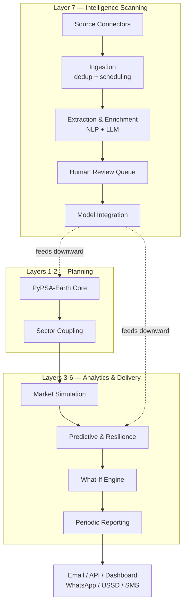

# ALEA — African Light and Energy Analytics

**An open, continental decision-support platform for African energy systems.**

ALEA forecasts the physical, market, financial, and strategic behaviour of
African power systems across all 55 African Union member states and the five
regional power pools — and delivers those forecasts through channels that reach
everyone from a national utility control room to a feature phone in rural
Malawi.

It is the successor to a South-Africa-only subscription report model
(COMPASS, Meridian Economics), widened in three directions at once: **scope**
(55 countries, not one), **time** (long-run planning *and* day-ahead operations),
and **audience** (an open platform, not a closed report).

---

## Table of contents

- [What ALEA answers](#what-alea-answers)
- [The seven layers](#the-seven-layers)
- [Architecture](#architecture)
- [Installation](#installation)
- [Quick start](#quick-start)
- [The signal contract](#the-signal-contract)
- [Repository layout](#repository-layout)
- [Development](#development)
- [Data sources](#data-sources)
- [Data completeness](#data-completeness)
- [Validation targets](#validation-targets)
- [Computational requirements](#computational-requirements)
- [Design principles](#design-principles)
- [Roadmap](#roadmap)
- [Specifications](#specifications)
- [Licence](#licence)

---

## What ALEA answers

Predictions are produced across four interconnected domains, moving from
physical outcomes to financial and strategic insight.

**Physical and operational.** The least-cost generation and transmission
capacity mix for every African country and power pool to 2060, across solar,
wind, geothermal, hydro, biomass, and marine resources. Hourly dispatch and
cross-border flows, with congestion and curtailment identified. Water–energy
nexus dynamics: how drought and changing hydrology move hydropower output and
constrain thermal plant cooling.

**Market and price.** Wholesale electricity price projections for all 55 member
states. Renewable capture prices at technology and country level, accounting for
cannibalisation as variable renewable penetration grows. PPA benchmark curves
adjusted for tenor, currency risk, and counterparty risk.

**Financial and risk.** Bankability metrics — DSCR, project IRR, equity IRR —
for generation and transmission projects under multiple scenarios. Value-at-Risk
and Conditional VaR for asset revenues and portfolios. Efficient frontiers
showing the trade-off between system cost and risk.

**Strategic and policy.** The price and investment impact of carbon taxes,
capacity markets, and renewable auctions. Market power and strategic bidding via
agent-based simulation. Climate resilience under CMIP6 scenarios from SSP1-2.6
through SSP5-8.5.

### Who uses it

ALEA serves the same archetypes as COMPASS — banks, investors, developers,
traders, large power users, policymakers — across every African market, and adds
national utilities, regulators, researchers, and continental institutions. The
strategy specification extends this to twenty archetypes including city
governments, journalists, healthcare facilities, insurers, and carbon markets,
with free access for citizens, researchers, and NGOs.

---

## The seven layers

Each layer depends only on the layers below it. This is the organising
constraint of the whole platform: it means any layer can be developed, tested,
and deployed independently, and a change in one cannot silently invalidate
another.

```
┌─────────────────────────────────────────────────────────────────────┐
│  Layer 7: Intelligence Scanning & Automated Data Collection         │
│  Continuous ingestion → extraction → review → model integration     │
├─────────────────────────────────────────────────────────────────────┤
│  Layer 6: Periodic Reporting & Intelligence                         │
│  Daily / weekly / monthly / quarterly / annual briefings            │
├─────────────────────────────────────────────────────────────────────┤
│  Layer 5: What-If Scenario Engine                                   │
│  Interactive parameters, rapid re-solve, efficient frontiers        │
├─────────────────────────────────────────────────────────────────────┤
│  Layer 4: Outage Prediction & Resilience Analytics                  │
│  VIIRS/Black Marble, ML forecasting, contingency analysis, TLENS    │
├─────────────────────────────────────────────────────────────────────┤
│  Layer 3: Market Simulation & Commercial Analytics                  │
│  Agent-based bidding, capture prices, PPA curves, risk metrics      │
├─────────────────────────────────────────────────────────────────────┤
│  Layer 2: Sector-Coupled Optimisation                               │
│  Electricity, hydrogen, heat, transport, industry, water            │
├─────────────────────────────────────────────────────────────────────┤
│  Layer 1: PyPSA-Earth Planning Core                                 │
│  Capacity expansion, multi-horizon, all renewable technologies      │
└─────────────────────────────────────────────────────────────────────┘
```

The scanning layer is the exception to "feeds upward": it sits *above* the
analytical stack and feeds data **downward** into Layers 1–6. It consumes no
analytical output, which is why it can be built and run while the layers below
it are still incomplete.

| Layer | Package | Specified entry points |
|---|---|---|
| 1 | `alea.planning` | Network construction, multi-horizon optimisation |
| 2 | `alea.sector` | Hydrogen, heat, transport, industry, water |
| 3 | `alea.market` | `GeneratorAgent`, `MarketModel`, capture prices |
| 4 | `alea.outages`, `alea.losses`, `alea.resilience` | `VIIRSOutageDetector`, `OutageForecaster`, `ContingencyAnalyser` |
| 5 | `alea.whatif` | `WhatIfEngine`, `ScenarioParameters` |
| 6 | `alea.reporting` | `DailyReportGenerator` … `AnnualReportGenerator` |
| 7 | `alea.scanning` | Source connectors, extraction, review queue, model updater |

> **Implementation status.** The package layout above is scaffolded — the
> directories exist and are importable — but only `alea.signals` is
> implemented. The entry points named in the right-hand column are the
> interfaces the specification calls for; none of them exist yet. See the
> [roadmap](#roadmap) for build order.

---

## Architecture



---

## Installation

Requires **Python 3.14+** and [uv](https://docs.astral.sh/uv/).

```sh
git clone https://github.com/nyimbi/alea.git
cd alea
uv sync --extra dev
```

Optional extras:

```sh
uv sync --extra solvers     # HiGHS via highspy, pulp
uv sync --extra notebooks   # JupyterLab
```

> **On TensorFlow.** The specification lists `tensorflow` as a dependency for
> outage models. It publishes no `cp314` wheel, and because `uv` locks every
> extra, an unsatisfiable extra fails the *entire* lock rather than just
> itself. The outage models are `xgboost`/`lightgbm` in any case, so the
> dependency is dropped rather than pinned to a version that cannot install.
> Reinstating it requires a Python downgrade.

Verify the install:

```sh
uv run pytest      # 9 passed
uv run pyright     # 0 errors
uv run ruff check  # All checks passed
```

---

## Quick start

### Working with signals

The scanning layer's output — and therefore the input to every analytical
layer — is a `Signal`: one machine-readable claim from one source document.

```python
from alea.signals.models import Signal, SignalType, Technology

signal = Signal(
    signal_type=SignalType.GENERATION_INVESTMENT,
    confidence=0.87,
    source_document_id="reuters_2026_03_01_a",
    source_url="https://example.org/kenya-solar-close",
    source_name="Reuters Africa",
    country_iso="ke",                 # normalised to "KE"
    region="Kajiado",
    latitude=-1.8521,
    longitude=36.7767,
    capacity_mw=100.0,
    technology=Technology.SOLAR,
    investment_usd=78_000_000,
    description="100 MW solar IPP reaches financial close in Kajiado County.",
    evidence_quotes=["...reached financial close on Friday..."],
)

assert signal.is_geolocated
assert signal.has_quantitative_payload
assert signal.requires_review is True   # nothing reaches a model unreviewed
```

### Solving a what-if scenario

The scenario engine is specified but not yet built; this is the interface it
will expose.

```python
from alea.whatif import WhatIfEngine, ScenarioParameters

engine = WhatIfEngine("results/base_network.nc")

frontier = engine.efficient_frontier(
    "carbon_price",
    values=[0, 50, 100, 150, 200],
    template=ScenarioParameters(demand_growth=0.04, coal_eaf=0.55),
)
```

### Running the test suite

```sh
uv run pytest -v
```

---

## The signal contract

`alea.signals.models.Signal` is the interface between the scanning layer and
everything else, and it is deliberately narrow. `spec4-data-collection.md`
defines it, and `spec4-ext.md`'s story detector consumes the same `signal_type`
values — so the taxonomy is load-bearing for both. Adding a member means
updating the story detector's newsworthiness rules.

**Signal taxonomy** (`SignalType`) — what a signal claims:

| Value | Model impact |
|---|---|
| `outage_event` | Updates outage history; triggers outage model retraining |
| `outage_cause` | Updates outage prediction features |
| `generation_investment` | Updates generation fleet and expansion options |
| `generation_retirement` | Updates generation fleet |
| `transmission_investment` | Updates transmission topology |
| `policy_change` | Updates policy parameters |
| `fuel_price_change` | Updates fuel cost parameters |
| `tender_rfp` | Updates project pipeline and investment options |
| `demand_signal` | Updates demand projections |
| `climate_event` | Updates climate risk scenarios |

Two invariants are enforced at construction, because violating either is worse
than emitting no signal at all:

- **No signal is anonymous or unqualified.** `source_document_id`,
  `source_url`, `source_name`, and `confidence` are required.
- **Coordinates come in pairs.** Latitude and longitude are present together or
  absent together. A latitude on its own cannot be mapped, and it is the
  signature of a geocoder that failed halfway.

`requires_review` defaults to `True`. Extraction is probabilistic — the
specification rates LLM hallucination as a medium-likelihood, high-impact risk —
so every signal carries `evidence_quotes` and nothing reaches a model without a
human confirming it.

---

## Repository layout

```
alea/
├── src/alea/
│   ├── signals/          # the signal contract (Layer 7 ↔ everything else)
│   ├── scanning/         # Layer 7 — connectors, extraction, review, integration
│   ├── planning/         # Layer 1 — PyPSA-Earth planning core
│   ├── sector/           # Layer 2 — sector coupling
│   ├── market/           # Layer 3 — market simulation
│   ├── outages/          # Layer 4 — VIIRS detection, forecasting, maintenance
│   ├── losses/           # Layer 4 — loss decomposition, TLENS, mitigation
│   ├── resilience/       # Layer 4 — ENS, EENS, SAIDI, SAIFI
│   ├── whatif/           # Layer 5 — scenario engine
│   ├── reporting/        # Layer 6 — periodic reports
│   └── api/              # REST API + dashboard
├── tests/ci/             # CI autodiscovery path — real objects, no mocks
├── config/               # Layer configs + scenario definitions
│   └── scenarios/
├── rules/                # Snakemake rules
├── scripts/              # Pipeline entry points
│   ├── download/  build/  solve/  predict/  analyse/
│   ├── scanning/         # connectors, extraction, ingestion, integration, review
│   ├── report/  bots/  media/  tools/  personalization/  api/
├── data/                 # Raw inputs (not versioned)
├── resources/            # Intermediate artefacts
├── results/              # Solved networks and model outputs
├── reports/              # Generated reports
│   └── daily/  weekly/  monthly/  quarterly/  annual/
├── envs/                 # Environment specifications
├── docs/                 # Platform documentation
└── spec/                 # The platform specification (authoritative)
```

---

## Development

```sh
uv run pytest              # tests/ci
uv run pyright             # type check, standard mode
uv run ruff check          # lint
uv run ruff check --fix
uv run pytest --cov=alea
```

### Conventions

- **Async throughout.** Async tests are plain `async def` functions with no
  `@pytest.mark.asyncio` decorator; `asyncio_mode = "auto"` handles them.
- **Tabs, not spaces.** Enforced by ruff (`indent-width = 4`,
  `E101`/`W191` ignored so tabs are the house style).
- **Modern typing.** `str | None`, `list[str]`, `dict[str, Any]`.
- **Pydantic v2** with `ConfigDict(extra="forbid", validate_by_name=True,
  validate_by_alias=True)`.
- **UUID7 identifiers** via `alea._uuid7.uuid7str()`. Time-ordered, so sorting
  by id sorts by creation time and ids cluster in B-tree indexes without
  leaking a sequence.
- **Runtime checks** at function start and end.
- **No mocks** except LLM calls. Use pytest fixtures, real objects, and
  `pytest-httpserver`.
- **Logging** methods are `_log_`-prefixed.

### Change strategy

1. Tests that verify current behaviour.
2. Failing tests for the new design.
3. Implement.
4. Full `tests/ci` pass.
5. Deduplicate test logic.
6. Update `docs/` and `examples/`.

---

## Data sources

ALEA is built on open data. The full inventory is in `spec/data3.md`; this is
the shape of it.

| Category | Primary sources |
|---|---|
| **Grid topology** | OpenStreetMap (Geofabrik Africa extract), World Bank Africa Electricity Grid Map |
| **Power plants** | `powerplantmatching`, RePP Africa, Global Energy Monitor Africa Energy Tracker, ECOWREX |
| **Renewables** | ERA5 reanalysis, Global Wind Atlas 3.0, Global Solar Atlas, PVGIS, SARAH-2, SWERA |
| **Hydro** | African Hydropower Atlas (Sterl et al.), AfREP-Hydro (IRENA), FAO Rivers of Africa |
| **Demand** | AFREC, WorldPop, Global Electrification Platform 3.0, DRE Atlas, GDP rasters |
| **Costs** | IRENA Renewable Cost Database, IEA, Global Petrol Prices, UNDP |
| **Policy** | AUDA-NEPAD Mwanga CMP, AEIS, PIDA, Africa Infrastructure Database |
| **Market** | SAWEM, SAPP DMS, WAPP ICC, EAPP OSeMOSYS, COMELEC, CAPP |
| **Outages** | NASA VIIRS Black Marble (VNP46A2), GridWatch ground truth |
| **Climate** | CMIP6 via ESGF and the Copernicus CDS, NASA NEX-GDDP-CMIP6 |
| **Sector coupling** | IEA Global Hydrogen Review, HyAfrica, Transport Starter Data Kits, AFREC industry data |

### Two methodological points that are load-bearing

**VIIRS angular correction.** Raw daily nighttime radiance fluctuates with the
satellite's changing viewing angle, which makes it unusable as-is. ALEA groups
observations by **Viewing Zenith Angle bin** and establishes the baseline as the
**first quartile of radiance per (pixel, VZA bin, month)**. The first quartile is
robust to occasional bright events (lunar reflection, fires) while preserving
sensitivity to darkening. This single step is the largest source of accuracy
improvement in the validated studies.

**Transmission losses.** PyPSA-Eur found that neglecting losses overestimates
optimal expansion by roughly 20%. Losses consume 15–25% of generated energy in
many African systems, so `transmission_losses` is enabled in the planning solve
rather than approximated away.

---

## Data completeness

Per-country completeness is assessed in `spec/data-completeness.md` against
seven independent sources (OASES/LEAP-RE, PyPSA-Earth continental validation,
GEP 3.0, DRE Atlas, AFREC, World Bank Grid Map, national portals).

| Tier | Count | Meaning |
|---|---|---|
| **HIGH** | 6 | Full GEP + DRE Atlas + AFREC + grid map; national open data portal; PyPSA-Earth validated |
| **MEDIUM** | 34 | GEP or DRE Atlas; AFREC; grid map; limited national open data |
| **LOW** | 8 | AFREC and grid map only |
| **CRITICAL** | 7 | Absent from continental datasets; proxy data required |

These counts are derived from the per-country tables in
`spec/data-completeness.md`, which sum to 55 — one row per AU member state. The
summary table at the end of that document disagrees with its own body: it
undercounts HIGH and MEDIUM, and lists Eritrea and Equatorial Guinea as MEDIUM
where the tables place both in LOW. Trust the tables.

**CRITICAL** countries — Burundi, Cabo Verde, Comoros, Djibouti, Mauritania,
Seychelles, São Tomé and Príncipe — are missing from both the OASES/IRENA
FlexTool continental dataset and GEP. Mitigation is proxy demand estimation from
WorldPop and GDP rasters, expert elicitation with national utilities and regional
bodies, and satellite-based asset detection.

Where data is unavailable, ALEA produces **uncertainty-quantified proxy
estimates validated against data-rich countries** — never silent interpolation.

---

## Validation targets

Each analytical module has a benchmark it must beat before it is trusted.

| Module | Target | Benchmark |
|---|---|---|
| Outage detection (VIIRS) | AUC > 0.80 | Ghana 0.8346; Johannesburg 89.41% accuracy |
| Outage forecasting (weather) | Accuracy > 95% | Adrar, Algeria 99% |
| Predictive maintenance | > 80% critical failure detection | Nigeria 87%; 64% false-alarm reduction |
| Loss approximation | < 2% error vs. full AC | PyPSA-Eur: neglecting losses overestimates expansion 20% |
| TLENS identification | Top 10 lines match expert ranking | Malawi: four critical corridors |
| What-if reproducibility | Identical to machine precision | Required for audit |
| Report accuracy | Zero data errors | Automated regression tests |
| Scanning precision | > 90% | Confirmed / (Confirmed + Rejected) |
| Scanning recall | > 85% | Confirmed / (Confirmed + Missed) |
| Ingestion latency | < 5 min from publication | Timestamp comparison |

---

## Computational requirements

| Tier | Use case | CPU | RAM | GPU | Storage |
|---|---|---|---|---|---|
| National | Single-country modelling | 32 cores | 128 GB | — | 2 TB SSD |
| Power pool | Regional modelling | 64 cores | 256 GB | — | 4 TB NVMe |
| Continental | All 55 countries | 128 cores | 512 GB | A100 optional | 10 TB NVMe |
| Training | Outage ML | 32 cores | 128 GB | A100 recommended | 2 TB SSD |
| Reporting | Continuous | 16 cores | 64 GB | — | 1 TB SSD |

Performance targets:

| Operation | Target |
|---|---|
| Continental LOPF (55 nodes, 8760 h) | < 6 hours |
| Continental CEP (2025–2060) | < 36 hours |
| Outage model training (5 years) | < 30 minutes |
| Outage forecast inference (24 h) | < 10 seconds |
| TLENS computation (200 lines) | < 2 hours |
| What-if solve (single) | < 2 hours |
| Daily report generation | < 5 minutes |

**Solver selection.** HiGHS (MIT, in-process via `highspy`) handles problems
under ~500k variables. Gurobi or CPLEX is required above 5M variables, where the
continental capacity-expansion problem sits.

---

## Design principles

1. **Continuous, not periodic.** The scanning layer runs hourly, not in batch.
2. **Indirect signals matter.** A news article about an outage in Lagos, a
   transformer explosion reported in Nairobi, and an RFP for a Zambian solar
   plant are all signals that should update the model.
3. **Human in the loop.** Extraction is probabilistic; the module produces
   *candidate* signals that analysts confirm, edit, or reject.
4. **Provenance and auditability.** Every signal carries source URL, timestamp,
   extraction confidence, and a chain of custody from raw data to model update.
5. **Modular and extensible.** New sources are addable without touching the core
   pipeline.
6. **Uncertainty-aware.** Every extracted signal carries an uncertainty estimate,
   and model updates propagate it.

---

## Roadmap

The specification's phased delivery, with the scanning layer moved first because
it has no dependencies.

| Phase | Deliverable | Depends on |
|---|---|---|
| **1. Data pipeline** | Africa data repository with quality scores | — |
| **2. Scanning core** | Connectors, ingestion, extraction, review queue | — |
| **3. Electricity model** | Working PyPSA-Earth Africa model | 1 |
| **4. Loss & resilience** | Loss decomposition, TLENS, ENS/SAIDI/SAIFI | 3 |
| **5. Sector coupling** | Hydrogen, heat, transport, industry | 3 |
| **6. All renewables** | Geothermal, biomass, marine, CSP | 3 |
| **7. Outage prediction** | VIIRS + weather + maintenance models | 1, 2 |
| **8. Market simulation** | Agent-based market model | 5 |
| **9. What-if engine** | Interactive scenario explorer | 8 |
| **10. API & dashboard** | REST API + Dash dashboard | 7–9 |
| **11. Reporting** | Daily → annual reports | 10 |
| **12. Validation** | Backtesting, cross-model comparison | all |
| **13. Production release** | Live platform | 12 |

---

## Specifications

`spec/` is the authority for what ALEA is meant to do. Where this README and a
specification disagree, the specification wins.

| File | Contents |
|---|---|
| `spec4-base.md` | The platform: seven layers, data pipeline, API, hardware, roadmap |
| `spec4-data-collection.md` | Layer 7 in detail — connectors, extraction, review, integration |
| `spec4-ext.md` | Strategy: 20 archetypes, 18 delivery channels, 30 capabilities, commercial model |
| `data3.md` | Data source inventory with verified links (**current**) |
| `data2.md`, `data1.md` | Earlier revisions of the same inventory |
| `data-completeness.md` | Per-country completeness tiers and mitigation |
| `users.md` | How ALEA differs from COMPASS |
| `analytics.md`, `competition-eval.md`, `best1.md`, `best1-renew.md` | Supporting analysis |
| `spec.md` → `spec3.md` | Superseded specification versions |

### Reading order for new contributors

1. `spec4-base.md` Parts I–III — what the platform is, and the data it needs.
2. `spec4-data-collection.md` — Layer 7, the only layer with no dependencies.
3. `spec/data-completeness.md` — where the data is thin, and what that costs.
4. `spec4-base.md` Parts IV–IX — the analytical layers you will build.

---

## Licence

MIT
